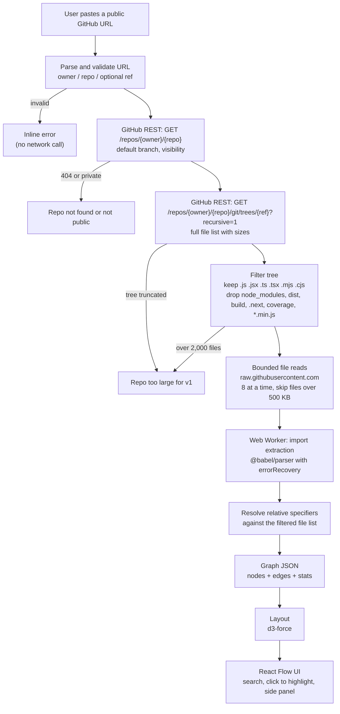

# RepoXray v1 architecture

How a pasted GitHub URL becomes an interactive import graph, and the decisions behind it.
Scope and acceptance criteria live in the [README](../README.md); this doc covers _how_.

---

## Data flow



Everything runs in the browser. RepoXray has no backend in v1 (see [API proxy decision](#api-proxy-decision)).

### Step by step

| #   | Step                | Input → Output                                                         | Notes                                                                                                                                        |
| --- | ------------------- | ---------------------------------------------------------------------- | -------------------------------------------------------------------------------------------------------------------------------------------- |
| 1   | **Parse URL**       | string → `{owner, repo, ref?}`                                         | Accepts `github.com/o/r`, `https://github.com/o/r(.git)`, `…/tree/<ref>`. Rejects anything else before any request (AC1).                    |
| 2   | **Repo metadata**   | `GET /repos/{o}/{r}` → `default_branch`, `private`                     | 404 → "Repo not found or not public" (AC2). Uses `ref` from the URL if given, else `default_branch`.                                         |
| 3   | **File tree**       | `GET /repos/{o}/{r}/git/trees/{ref}?recursive=1` → every path + `size` | One call for the whole repo. If `truncated: true`, stop with "too large".                                                                    |
| 4   | **Filter**          | tree → list of analysable files                                        | Extensions and ignored folders per README scope. Uses `size` from the tree, so oversized files are skipped **without downloading them**.     |
| 5   | **Bounded reads**   | paths → file text                                                      | `https://raw.githubusercontent.com/{o}/{r}/{ref}/{path}`. Concurrency 8, 10 s timeout, 1 retry. Not counted against the REST API rate limit. |
| 6   | **Extract imports** | file text → specifiers                                                 | Runs in a Web Worker so the UI stays responsive. Text is parsed, **never executed**.                                                         |
| 7   | **Resolve**         | specifier + importer path → target path or unresolved                  | Rules below. Only `./` and `../` specifiers are considered.                                                                                  |
| 8   | **Graph JSON**      | resolved edges → `RepoGraph`                                           | Schema below. This is the boundary between "analysis" and "UI".                                                                              |
| 9   | **Render**          | `RepoGraph` → interactive graph                                        | d3-force computes positions once; React Flow draws, pans, zooms and handles clicks.                                                          |

---

## MVP stack

| Layer           | Choice                                                                  | Why                                                                                                                                                                                                          |
| --------------- | ----------------------------------------------------------------------- | ------------------------------------------------------------------------------------------------------------------------------------------------------------------------------------------------------------ |
| Build tool      | **Vite**                                                                | Fast dev server, simple static build, first-class TS and Web Worker support (`new Worker(new URL(...), { type: 'module' })`).                                                                                |
| UI              | **React 19**                                                            | Required by React Flow; biggest ecosystem for the side panel/search UI.                                                                                                                                      |
| Language        | **TypeScript (strict)**                                                 | Graph JSON types are shared between worker and UI; catches resolver bugs early.                                                                                                                              |
| Graph rendering | **React Flow** (`@xyflow/react`)                                        | Pan/zoom/drag/select built in; custom node components for highlighting.                                                                                                                                      |
| Layout          | **d3-force**                                                            | React Flow has no auto-layout. A force layout matches the README's "force-directed graph" and suits import graphs, which aren't trees. Run it to a fixed number of ticks, then hand positions to React Flow. |
| Import parsing  | **@babel/parser** (`typescript` + `jsx` plugins, `errorRecovery: true`) | One parser for all six extensions. `errorRecovery` keeps going on syntax errors (AC8). Regex would break on comments and strings.                                                                            |
| Tests           | **Vitest**                                                              | Same config as Vite; unit tests for URL parsing, extraction and resolution (AC9).                                                                                                                            |
| Lint/format     | oxlint + Prettier                                                       | oxlint ships with the current Vite template and is much faster than ESLint.                                                                                                                                  |
| Hosting         | **Vercel** (static site)                                                | Free, deploys from GitHub on every push, no server needed in v1.                                                                                                                                             |

**Not used in v1:** a backend, a database, auth, any AI/LLM service.

---

## API proxy decision

**Decision: no proxy in v1. The browser calls GitHub directly.**

| Option                                       | Pros                                                                                                                                                        | Cons                                                                     |
| -------------------------------------------- | ----------------------------------------------------------------------------------------------------------------------------------------------------------- | ------------------------------------------------------------------------ |
| **A. Direct from browser** ✅                | No server, no token to protect, no hosting cost, nothing to break. GitHub's API and `raw.githubusercontent.com` both send `Access-Control-Allow-Origin: *`. | Unauthenticated REST limit is **60 requests/hour per user IP**.          |
| B. Serverless proxy with a server-side token | 5,000 requests/hour shared; can cache results.                                                                                                              | A server to build, secure and pay for; token abuse risk; slower to ship. |

**Why A works:** each analysis makes only **2 REST API calls** (metadata + tree). File contents come from `raw.githubusercontent.com`, which is not part of the REST API's rate limit. That gives each user about **30 analyses per hour**, plenty for v1.

**When to revisit (switch to B):** if users regularly hit the 403 rate-limit message, or once caching (#26) is worth building. Then add a small Vercel function at `/api/github/*` that adds a server token and caches by `owner/repo@commit-sha`. The UI already talks to a single `github.ts` module, so swapping the base URL is a one-file change.

When a limit is hit, the UI shows the reset time from GitHub's `x-ratelimit-reset` header (AC3).

---

## Limits

| Limit                       | Value         | Behaviour when hit                                                               |
| --------------------------- | ------------- | -------------------------------------------------------------------------------- |
| REST API calls per analysis | 2             | —                                                                                |
| Analysable files per repo   | 2,000         | Stop before downloading: "This repo has N JS/TS files; v1 supports up to 2,000." |
| Tree truncated by GitHub    | —             | Same "too large" message.                                                        |
| Max size of one file        | 500 KB        | Shown as a node marked _too large_, no edges. Usually generated or bundled code. |
| Total bytes downloaded      | 25 MB         | Stop and show a partial-analysis warning.                                        |
| Parallel file requests      | 8             | Keeps the browser and GitHub happy.                                              |
| Per-file timeout            | 10 s, 1 retry | Node marked _fetch failed_, analysis continues.                                  |
| Parse failure               | —             | Node kept, no edges, marked _parse error_ (AC8).                                 |
| Rendered nodes              | ≤ 2,000       | React Flow with `onlyRenderVisibleElements` for performance.                     |

Target: a ~500-file repo goes from paste to graph in under 10 s (AC10).

---

## Import extraction

Recognised forms (README AC6). Only string-literal specifiers count:

```ts
import x from './a'; // kind: "import"
import './side-effect'; // kind: "import"
import type { T } from './t'; // kind: "import" (type-only imports still show structure)
export { y } from './b'; // kind: "export-from"
export * from './c'; // kind: "export-from"
const z = require('./d'); // kind: "require"
const m = await import('./e'); // kind: "dynamic-import"
```

Ignored: package imports (`react`, `@scope/pkg`), aliases (`@/components`), template literals or variables in `import()`/`require()`.

## Resolution rules

For specifier `s` in file `dir/file.ts`, compute `p = normalize(dir + '/' + s)` and pick the first match in the filtered file list:

1. `p` exactly (if it has a supported extension)
2. `p` + `.ts`, `.tsx`, `.js`, `.jsx`, `.mjs`, `.cjs`
3. `p` + `/index` + each extension above
4. If `s` ends in `.js`/`.jsx`/`.mjs`/`.cjs`, try the same path with `.ts`/`.tsx`/`.mts`/`.cts` (TypeScript ESM projects import `./foo.js` that is really `foo.ts`)

No match → counted as _unresolved_ (e.g. `./styles.css`, `./data.json`, or a missing file). Not drawn, but shown in stats.

---

## Graph JSON

The contract between the analysis pipeline and the UI:

```ts
type NodeStatus = 'ok' | 'parse-error' | 'too-large' | 'fetch-failed';
type EdgeKind = 'import' | 'export-from' | 'require' | 'dynamic-import';

interface RepoGraph {
  repo: { owner: string; name: string; ref: string; htmlUrl: string };
  nodes: Array<{
    id: string; // file path, e.g. "src/lib/parser.ts" (unique)
    folder: string; // top-level folder, used for colour; "" for root files
    ext: string; // ".ts"
    size: number; // bytes, from the tree
    status: NodeStatus;
  }>;
  edges: Array<{
    id: string; // `${source}->${target}`
    source: string; // importer node id
    target: string; // imported node id
    kinds: EdgeKind[]; // one edge per file pair; all forms seen
    specifiers: string[]; // raw text, e.g. ["./parser"]
  }>;
  stats: {
    files: number;
    edges: number;
    unresolved: number;
    skipped: number; // too large + fetch failed
    durationMs: number;
  };
}
```

Edges are de-duplicated per file pair, so importing two things from the same file draws one line.

---

## Planned source layout

```
src/
  lib/
    parseRepoUrl.ts     # step 1
    github.ts           # steps 2, 3, 5: only module that talks to GitHub
    filterTree.ts       # step 4
    resolve.ts          # step 7
    buildGraph.ts       # step 8
    types.ts            # RepoGraph and friends
  worker/
    analyze.worker.ts   # steps 6 to 8, off the main thread
  components/
    UrlForm.tsx
    GraphView.tsx       # React Flow + d3-force layout
    SearchBox.tsx
    SidePanel.tsx
  App.tsx
tests/
  parseRepoUrl.test.ts
  extract.test.ts
  resolve.test.ts
```

## Security notes

- Repository code is only ever treated as **text**. It is never `eval`'d, imported or run.
- File names and paths are rendered as text (React escapes them by default; no `dangerouslySetInnerHTML`).
- No tokens or user credentials exist in v1, so there's nothing to leak.
